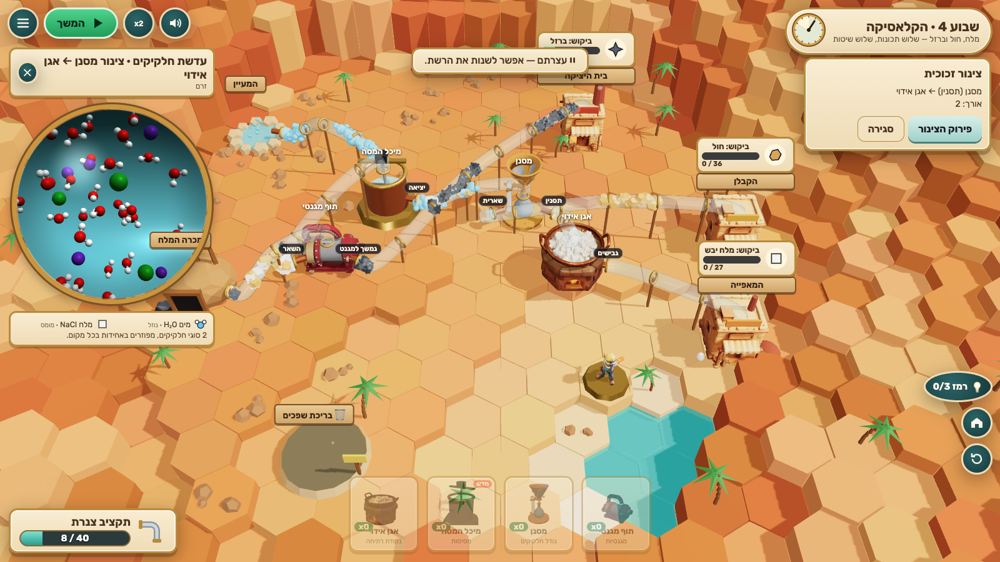

# Clean Flow — זרם נקי

A 3D browser game for Hebrew-speaking grade-8 science students, built on the Israeli curriculum as published in [Workbook](https://science.workbook.co.il/grade-8) (chapter 3: compounds, mixtures and separation).

**Mini Metro meets a chemistry plant.** Mixed-up streams pour out of mines, springs, marshes and spills in a sunlit desert valley. Towns and workshops want pure stuff. Lay glass pipes, drop brass separation machines in the right order, and watch every particle ride the pipes — when you get it wrong you *see* the salt sail straight through your filter and the bakery spit out sandy salt.



## Play

```bash
npm install
```

```bash
npm run dev
```

Open http://localhost:5195/ (strict port). Production build and preview:

```bash
npm run build
```

```bash
npm run preview
```

(http://localhost:4195/). The build is fully static and offline: fonts and models are bundled, nothing is fetched at runtime, no backend, accounts, analytics or API keys.

## Controls

| Action | Mouse / touch | Keyboard |
|---|---|---|
| Place a machine | Drag a card from the tray onto a free hexagon (or tap the card, then tap a hexagon) | `1`–`8` selects a tray card |
| Draw a pipe | Drag from an outlet ring (source or machine) to a machine, customer or the waste pond — or tap the outlet, then tap the target | |
| Look inside a stream (particle lens) | Tap a source or a pipe | |
| Classify a stream | Stamp it in the lens: יסוד / תרכובת / תערובת הומוגנית / תערובת הטרוגנית | |
| Machine settings / move / remove | Tap the machine (still: 78 °C / 100 °C) | `Delete` removes the selected pipe or machine |
| Open the valves / pause | ▶ button | `Space` |
| Speed ×2 | ×2 button | `F` |
| Rerun (network kept) | ↻ button | `R` |
| Hint (weeks 1–5) | 💡 button | `H` |
| Camera | Drag ground: pan · right-drag / two fingers: rotate · wheel / pinch: zoom · ⌂ button: whole valley | arrows/WASD pan, `C` home |

Mute, reduced motion and the full control list are in the menu (☰) and on the title screen.

## What's in the slice (implemented)

- **Six weeks** (6–10 minutes total): Iron Week (magnet; a spring that needs nothing), Salt Week (filter, evaporation pan, still; a new source appears mid-week), Oil Week (separating funnel; clear sugar water that isn't water), The Classic (salt + sand + iron: magnet → dissolve → filter → evaporate), Ink & Spirits (chromatography; distillation at 78 °C vs 100 °C; air as a lens-only classification trap) and **Flood Day**, a no-hint transfer week with four never-seen streams (copper-sulfate water + gravel, vinegar + oil, iron + sulfur powder, iron sulfide).
- Authoritative pure-TypeScript simulation (`src/sim/`): substances with real properties, classification derived from particle data, 8 machines as mass-conserving functions, packet flow through pipes with queues, stalls, backlogs, floods, customer purity checks.
- 3D valley (Three.js): terraced sandstone hex board inside a canyon, lake, palms, day→dusk light per week, glass pipes with instanced particles coded by shape *and* colour, animated machines, steam/sparks/particle bursts, camera shake, a rigged Tripo engineer mascot who cheers or facepalms.
- Particle lens: a live ball-and-stick 3D view of any stream (ions when dissolved, crystals/grains when solid, layers when immiscible), legend with formulas and states, class stamps with first-try bonus.
- Week 1 coach marks, progressive hints (logged), failure screens with a short worked explanation (none in the transfer week), stars (done / all stamps right first try / zero rejections within the machine par), week-end upgrade pick (+5 pipe or bigger reservoirs).
- Hebrew RTL UI (bundled Rubik), formulas and numbers isolated LTR, never colour-only feedback, mute / pause / reduced motion, keyboard + touch, DPR capped at 2, pause on focus loss, resize, WebGL context-loss message.
- Anonymous local learning log (localStorage `cleanflow.log.v1`).
- Test hooks: `window.render_game_to_text()` and deterministic `window.advanceTime(ms)`; read-only locators in `window.cf`.

## Planned / not in this slice

- A persistent valley that grows across weeks (each week is currently its own valley layout).
- Splitter junctions and throughput upgrades (faster still, pipe bridges).
- Tripo idle/facepalm animation clips (idle and facepalm are procedural poses on the rigged model).
- More Tripo machines (dissolving tank, funnel, chromatography tower, sieve, sources are procedural).

## Tests

```bash
npm test
```

67 unit tests: classification, mass conservation for every machine, station physics, customer judging, every level's intended network wins in the full simulation, wrong orders fail with the advertised rejection, the transfer week rejects every constant strategy (every single machine type and every two-machine chain applied to all streams). Headless playthroughs with real mouse input:

```bash
node scripts/playtest.mjs campaign
```

(needs the dev server; also `week1`, `week1-fail`, `mobile`, `review`). See [PLAYTEST.md](PLAYTEST.md).

## Deploy to Vercel

Static Vite app with a relative base. In Vercel: import `AceDZN/clean-flow`, framework preset **Vite**, build command `npm run build`, output directory `dist`. `vercel.json` already sets these. No environment variables.

## Docs

[GAME_IDENTITY.md](GAME_IDENTITY.md) · [CURRICULUM.md](CURRICULUM.md) · [ASSETS.md](ASSETS.md) · [PLAYTEST.md](PLAYTEST.md) · [progress.md](progress.md) · [docs/VISUAL_REVIEW.md](docs/VISUAL_REVIEW.md) · mockups in [docs/visual-targets/](docs/visual-targets/) · real captures in [docs/captures/](docs/captures/) · brief in [docs/handoff/](docs/handoff/)
