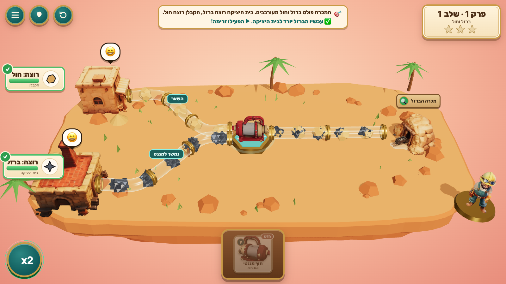

# Clean Flow — זרם נקי

A 3D browser puzzle game for Hebrew-speaking grade-8 science students, built on the Israeli curriculum as published in [Workbook](https://science.workbook.co.il/grade-8) (chapter 3: compounds, mixtures and separation).

**Mixed-up streams pour out of mines, marshes and spills. Every town wants exactly one pure thing.** The glass pipes are already laid; drag the right brass machine into each glowing socket, flip it so each product goes the right way, and press ▶. Particles you can see ride the pipes — iron jumps to the magnet, sand stays on the filter, steam leaves the pan — and customers cheer or spit out the wrong stuff.



This is **v2**, a redesign after the first playtest ("barely understood what to do… boring… too hard because of the flow and controls"). See [docs/REDESIGN.md](docs/REDESIGN.md). v1 (free-form network building) is retired; its captures stay in [docs/captures/](docs/captures/) for history.

## Play

```bash
npm install
```

```bash
npm run dev
```

Open http://localhost:5195/ (strict port). Production build and preview:

```bash
npm run build
```

```bash
npm run preview
```

(http://localhost:4195/). The build is static and offline: fonts and Tripo models are bundled; no backend, accounts, analytics or API keys.

## How to play

| Action | Mouse / touch | Keyboard |
|---|---|---|
| Choose a level | Tap a badge on the map | |
| Place a machine | Drag a card from the tray onto a glowing socket — or tap the card, then tap the socket | `1`–`6` selects a card |
| Which socket fits | **Y** cards (two outlets: magnet, filter, funnel, still, chromatography, sieve) go in hexagonal fork sockets; **●** cards (evaporation pan, dissolving tank) go in round sockets. Empty round socket = plain pipe; empty fork = the stream splits in half | |
| Flip outlets / thermometer / remove | Tap the placed machine | |
| Look inside a stream (scan) | Tap the source or its 🔍 sign; stamp it יסוד / תרכובת / תערובת הומוגנית / הטרוגנית | `Esc` closes |
| Run | ▶ הפעל זרימה (during the run the button is ×2 speed) | `Space` / `Enter` |
| Hint / start over / map | 💡 / ↻ / ☰ (top-left) | `H` / `R` |

Stars: ★ solved · ★ solved without a failed run · ★ every source scanned and stamped correctly on the first try.

## What's in it

- **14 puzzles in 6 chapters**: magnet; filter + evaporation + distillation; layers (separating funnel) and "clear ≠ pure"; the salt-sand-iron classic (magnet → dissolve → filter → evaporate, where the order really matters); chromatography and ethanol distillation (78 °C vs 100 °C); and **יום השיטפון**, three no-hint transfer puzzles with new streams (copper-sulfate water + gravel, vinegar + oil, iron + sulfur, iron sulfide).
- Pure TypeScript rules (`src/sim/` chemistry, `src/puzzle/engine.ts` puzzle graph) with a brute-force solver test: every level has exactly one intended solution (one has a second, physically valid one), empty sockets never win, the classic mistakes fail as designed, and no single machine type used everywhere can clear the transfer chapter.
- 3D (Three.js): floating layered-sandstone islands, thick glass pipes with brass couplers, particles coded by shape and colour, 14 Tripo models (machines, mine, reservoir, foundry, bakery, workshop, rigged engineer with idle / cheer / frustrated animations), scan magnifier with a live 3D particle view, 3D level map.
- Hebrew RTL UI (bundled Rubik), formulas in LTR spans, colour never the only signal, phone layout (the camera turns so the board runs up the screen), reduced-motion and mute toggles.
- Anonymous local learning log in `localStorage` (`cleanflow.log.v1`): placements, flips, runs, stamps, hints, wins, failures, first unaided decisions. Progress in `cleanflow.v2.progress`.
- Test hooks: `window.render_game_to_text()`, deterministic `window.advanceTime(ms)`, read-only locators in `window.cf`.

## Tests

```bash
npm test
```

```bash
node scripts/play2.mjs campaign
```

The second command (needs the dev server) solves all 14 puzzles through the UI with real mouse input; also `shots`, `fail`, `mobile`. See [PLAYTEST.md](PLAYTEST.md).

## Deploy to Vercel

Static Vite app with a relative base: import `AceDZN/clean-flow`, framework **Vite**, build `npm run build`, output `dist` (`vercel.json` sets these). No environment variables.

## Docs

[docs/REDESIGN.md](docs/REDESIGN.md) · [GAME_IDENTITY.md](GAME_IDENTITY.md) · [CURRICULUM.md](CURRICULUM.md) · [ASSETS.md](ASSETS.md) · [PLAYTEST.md](PLAYTEST.md) · [progress.md](progress.md) · [docs/VISUAL_REVIEW.md](docs/VISUAL_REVIEW.md) · mockups [v2](docs/visual-targets/v2/) · captures [v2](docs/captures/v2/) · brief [docs/handoff/](docs/handoff/)
